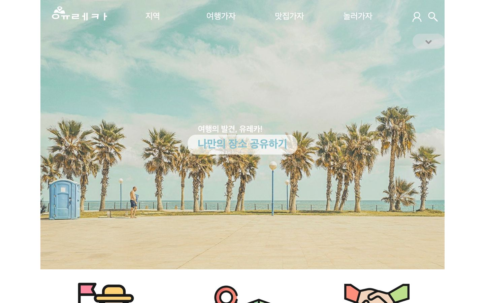
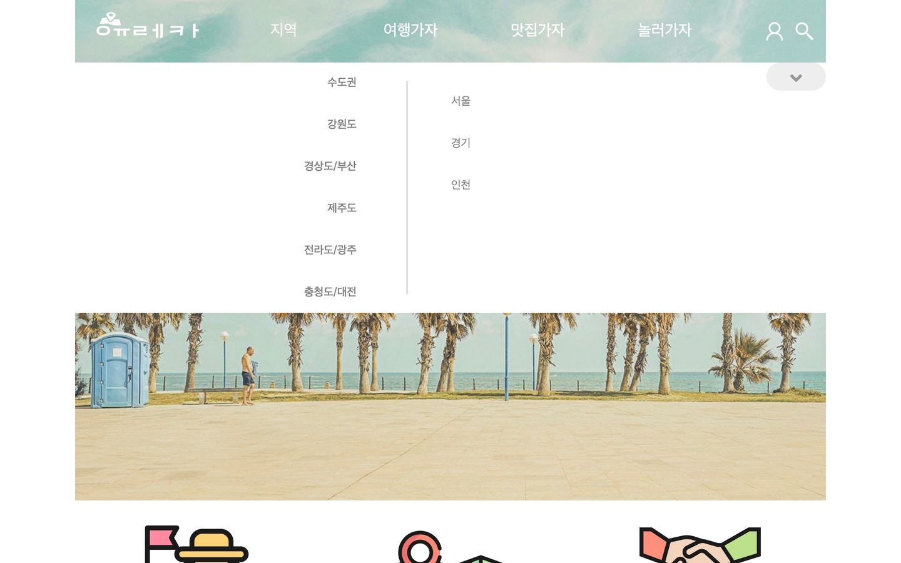
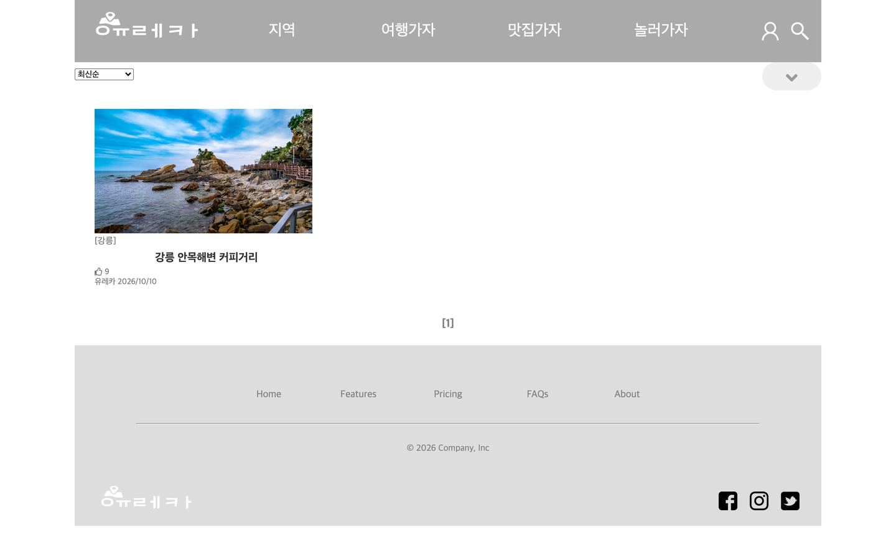
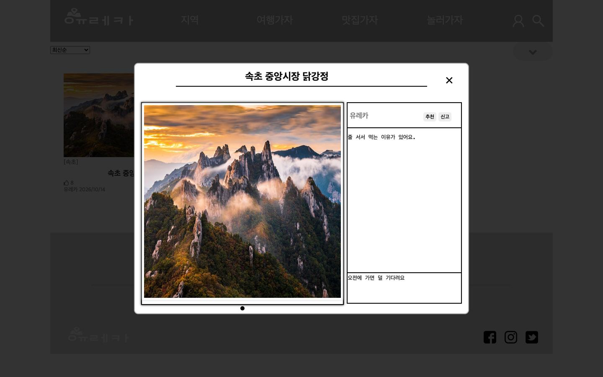
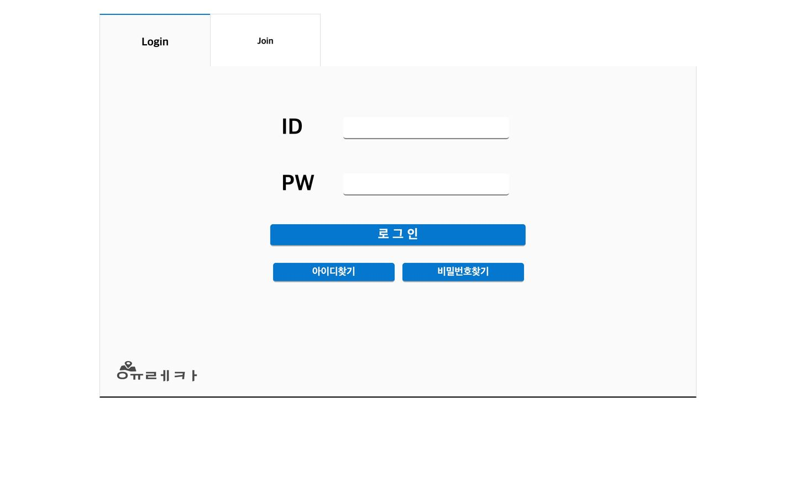
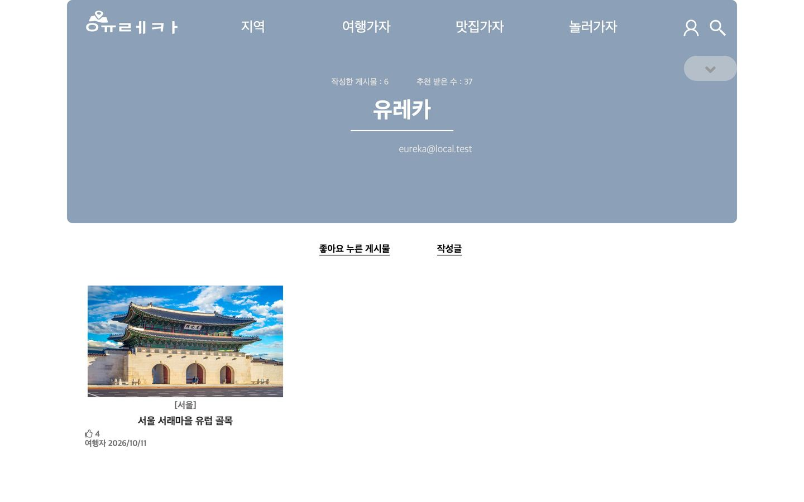
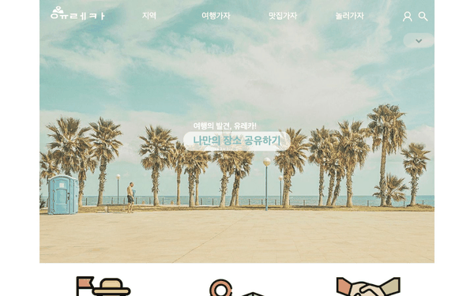

# Eureka 2021 - 원본 '유레카' (JSP)

2021년 중앙HTA 팀 프로젝트로 만든 여행 장소 공유 커뮤니티 **'유레카'의 원본 코드**입니다.
원본 레포 [hanheeda/teamZoom](https://github.com/hanheeda/teamZoom)을 포크해, 지금 로컬에서 다시 실행할 수 있게 실행 도구를 더했습니다.

2026년에 같은 구조를 최신 스택으로 다시 만든 버전은 [Eureka-FE](https://github.com/WONJUN-KR/Eureka-FE) · [Eureka-BE](https://github.com/WONJUN-KR/Eureka-BE)에 있습니다.

---

## 화면

| 메인 | 지역 메뉴 |
| --- | --- |
|  |  |

| 게시글 목록 | 읽기 창 |
| --- | --- |
|  |  |

| 로그인 · 회원가입 | 마이페이지 |
| --- | --- |
|  |  |

**글 등록 흐름** - 카테고리 → 지역 → 누구와 → 세부 테마 → 이미지 → 제목·내용 → 업로드 → 목록·읽기 창


**메인 페이지 전체** - 배너 · 장점 · 이 달의 Best 픽 · 떠나기 좋은 도시 · 제휴 광고



나머지 캡처는 [docs/screenshots](docs/screenshots)에 있습니다.

---

## 기술 스택 (2021)

- JSP · Servlet (Tomcat 9) · Java 8
- jQuery · slick · bxSlider
- Oracle (JDBC, DAO 직접 작성) · cos.jar 파일 업로드

## 로컬에서 실행

필요: Docker, JDK 17, curl

```bash
bash local/run.sh        # Oracle Free(docker) + Tomcat 9 → http://localhost:8099/form/mainPage.jsp
bash local/run.sh stop   # 정지
```

- 처음 실행하면 Oracle 이미지와 Tomcat 9, Oracle JDBC 드라이버를 받습니다(Tomcat은 sha512 확인)
- 테스트 계정은 [local/schema-seed.sql](local/schema-seed.sql) 주석에 있습니다(로컬 전용)

### 2021 원본에서 바꾼 것 (실행에 필요한 최소한)

| 원본 | 지금 | 이유 |
| --- | --- | --- |
| DAO마다 팀 AWS RDS 주소·계정이 코드에 적혀 있음 | `dao/DbConfig` 한 곳에서 환경변수(`EUREKA_DB_URL` 등)로 받고, 없으면 로컬 docker DB | 지금은 없는 DB이고, 접속 정보를 코드에 두지 않기 위해 |
| DB 덤프 없음 | `local/schema-seed.sql` | 원본 DAO SQL·VO·글쓰기 화면 목록으로 테이블과 데이터를 다시 만듦(게시글 내용은 예시) |
| ojdbc6 | ojdbc11 | ojdbc6 는 최신 Oracle(23)에 접속하지 못함 |

화면·JSP·CSS·JS는 원본 그대로입니다. 읽기 창 아래 칸에 `null`이 보이는 것도 원본 동작입니다(글쓰기 창에 해당 입력란이 없음).

### 캡처 다시 찍기

```bash
node --experimental-websocket local/capture.mjs   # 화면 14장 → docs/screenshots
node --experimental-websocket local/record.mjs    # 메인 스크롤 · 글 등록 GIF
```

Chrome headless(CDP)로 찍고, GIF는 `local/frames2gif.py`(Pillow)로 만듭니다.
